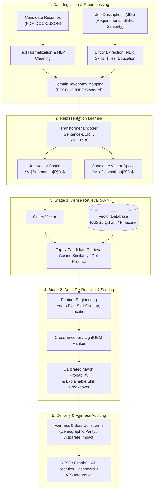

# HR Talent Match & Recommendation Engine

An end-to-end **Information Retrieval (IR)** and **Recommender Systems (RecSys)** platform designed to solve the talent-to-job matching problem using semantic search, vector embeddings, multi-stage retrieval, and neural ranking.

---

## 📌 Executive Summary

While interactive game AI focuses on real-time spatial navigation and survival policies, the **HR Recommendation Engine** addresses an asynchronous, high-dimensional semantic matching problem: finding the optimal alignment between unstructured candidate profiles (resumes, skill sets, career trajectories) and structured job requisitions.

The system implements a modern **Two-Stage Recommendation Pipeline**:
1. **Candidate Retrieval (Candidate Generation):** Fast approximate nearest neighbor (ANN) search over dense vector embeddings.
2. **Re-Ranking (Scoring Stage):** Deep cross-encoder or gradient-boosted decision trees (GBDT) optimizing for ranking metrics like $\text{NDCG}@K$ and precision.

---

## 🏛️ System Architecture



---

## ⚖️ Deep Comparison: Bomberman AI Lab vs. HR Recommendation Engine

Understanding the fundamental shift between these two systems is essential for machine learning engineering across different AI paradigms:

| Architectural Dimension | 💣 Bomberman AI Combat Lab | 👔 HR Recommendation Engine |
| :--- | :--- | :--- |
| **Primary Domain** | Real-Time Game AI & Behavioral Policy | Semantic Information Retrieval & Recommender Systems |
| **Problem Formulation** | Markov Decision Process (MDP) / Sequential Control | Two-Stage Retrieval and Learning-to-Rank (LTR) |
| **Input Data Modality** | Vision / Spatial: $32 \times 32$ luminance grid + map sensors | Unstructured text (NLP), skill graphs, and tabular metadata |
| **Data Representation** | Dense pixel arrays $[0.0, 1.0]$ and discrete distance maps | Semantic text embeddings ($d = 384$ or $768$) via Transformers |
| **Model Architecture** | Deep MLP (2 Hidden Layers) + Softmax over actions | Two-Tower Vector Encoder + Cross-Encoder / GBDT Re-Ranker |
| **Decision Frequency** | Synchronous, high-frequency (every 220ms, 60 FPS tick) | Asynchronous, on-demand query or batch-scheduled scoring |
| **Execution Environment** | Client-side multithreading (**Web Worker**) | Distributed backend services (FastAPI, Redis, Vector DB) |
| **Target Function / Loss** | Action Cross-Entropy: $\mathcal{L} = -\log(P_{\text{correct action}})$ | Contrastive / Triplet Loss + RankNet / LambdaMART |
| **Core Objective** | Survival, escape via BFS, and zero-sum elimination | Maximum relevance ranking, career fit, and precision |
| **Key Evaluation Metrics** | Kill/Death ratio, time to victory, HP preservation | $\text{Precision}@K$, $\text{Recall}@K$, $\text{NDCG}@K$, $\text{MRR}$ |
| **Ethical & Safety Focus** | Obstacle collisions and bomb blast self-immunity | Algorithmic fairness, demographic parity, and bias mitigation |

---

## 🔬 Core Mathematical Formulations

### 1. Semantic Similarity (Candidate Retrieval)
The first stage measures the cosine angle between candidate vector $v_c$ and job vector $v_j$ in the embedding space $\mathbb{R}^d$:

$$\text{Sim}(v_c, v_j) = \frac{v_c \cdot v_j}{\|v_c\|_2 \|v_j\|_2} = \frac{\sum_{i=1}^d v_{c,i} v_{j,i}}{\sqrt{\sum_{i=1}^d v_{c,i}^2} \sqrt{\sum_{i=1}^d v_{j,i}^2}}$$

### 2. Contrastive Learning (Representation Optimization)
To train the Two-Tower embedding model, matching candidate-job pairs $(c_i, j_i)$ are pulled together while non-matching pairs $(c_i, j_k)$ are pushed apart using InfoNCE Loss:

$$\mathcal{L}_{\text{InfoNCE}} = -\log \frac{\exp\left(\text{sim}(v_{c_i}, v_{j_i}) / \tau\right)}{\sum_{k=1}^B \exp\left(\text{sim}(v_{c_i}, v_{j_k}) / \tau\right)}$$

where $\tau$ is a temperature hyperparameter and $B$ is the batch size.

### 3. Ranking Quality: Normalized Discounted Cumulative Gain ($\text{NDCG}@K$)
Measures the quality of the ranked candidate list against human recruiter relevance labels $r_i \in \{0, 1, 2, 3\}$:

$$\text{DCG}@K = \sum_{i=1}^K \frac{2^{r_i} - 1}{\log_2(i + 1)}, \qquad \text{NDCG}@K = \frac{\text{DCG}@K}{\text{IDCG}@K}$$

where $\text{IDCG}@K$ is the Ideal DCG achieved by sorting candidates perfectly.

---

## 🛠️ Technology Stack

* **Language & Runtime:** Python 3.11+
* **NLP & Embeddings:** Hugging Face Transformers, `sentence-transformers`, SpaCy (Custom NER for skills extraction)
* **Vector Indexing (ANN):** Qdrant / FAISS (HNSW graph indexing)
* **Re-Ranking:** LightGBM (LambdaMART objective) or Cross-Encoder (`ms-marco-MiniLM-L-6-v2`)
* **API & Serving:** FastAPI, Pydantic, Celery, Redis
* **Fairness & Auditing:** AIF360, Fairlearn (Disparate Impact ratio checking)

---

## 📂 Project Directory Structure

```text
hr-recommendation/
├── data/
│   ├── raw/                      # Anonymized resumes and job descriptions
│   ├── processed/                # Normalized tokenized profiles and parsed skills
│   └── taxonomies/               # O*NET and ESCO skill trees
├── models/
│   ├── encoders/                 # Fine-tuned Two-Tower transformer weights
│   └── rankers/                  # Serialized GBDT / LightGBM ranker models
├── src/
│   ├── api/
│   │   ├── routes.py             # Recommendation endpoints (/recommend, /match)
│   │   └── schemas.py            # Pydantic request/response data contracts
│   ├── nlp/
│   │   ├── parser.py             # Resume & JD entity extraction (NER)
│   │   ├── cleaner.py            # Text normalization and token reduction
│   │   └── taxonomy_matcher.py   # Exact and fuzzy skill graph mapping
│   ├── indexing/
│   │   ├── vector_store.py       # Qdrant/FAISS collection management
│   │   └── embedder.py           # Dense vector encoding pipeline
│   ├── ranking/
│   │   ├── candidate_gen.py      # Stage 1: ANN fast vector retrieval
│   │   └── cross_encoder.py      # Stage 2: Deep pairwise/listwise scoring
│   └── evaluation/
│       ├── metrics.py            # NDCG, Precision@K, and MAP evaluators
│       └── fairness.py           # Demographic parity & disparate impact testing
├── tests/                        # Unit and integration test suite
├── Dockerfile                    # Containerization specification
├── requirements.txt              # Production Python dependencies
└── README.md                     # Project documentation
```

---

## 🚦 Getting Started

### 1. Environment Setup
```bash
# Clone the repository
git clone https://github.com/your-org/hr-recommendation.git
cd hr-recommendation

# Create and activate virtual environment
python -m venv .venv
source .venv/bin/activate  # On Windows: .venv\Scripts\Activate.ps1

# Install dependencies
pip install -r requirements.txt
```

### 2. Build the Vector Index
```bash
# Parse sample profiles and build local HNSW index
python -m src.indexing.vector_store --rebuild-index
```

### 3. Launch the API Service
```bash
uvicorn src.api.routes:app --host 0.0.0.0 --port 8000 --reload
```

Interactive API documentation will be available at `http://localhost:8000/docs`.

---

## 🔍 Example Recommendation Request

**Endpoint:** `POST /api/v1/recommend`

```json
{
  "job_id": "job_devops_sr_04",
  "title": "Senior Cloud Platform Engineer",
  "required_skills": ["Kubernetes", "Terraform", "Go", "AWS", "CI/CD"],
  "min_experience_years": 5,
  "top_k": 3
}
```

**Response:**
```json
{
  "job_id": "job_devops_sr_04",
  "total_retrieved": 120,
  "top_recommendations": [
    {
      "candidate_id": "cand_9412",
      "final_score": 0.942,
      "stage1_vector_similarity": 0.887,
      "skill_match_percentage": 0.92,
      "matched_skills": ["Kubernetes", "Terraform", "AWS", "CI/CD"],
      "missing_skills": ["Go"],
      "experience_years": 6.5,
      "fairness_flag": "PASSED"
    }
  ]
}
```