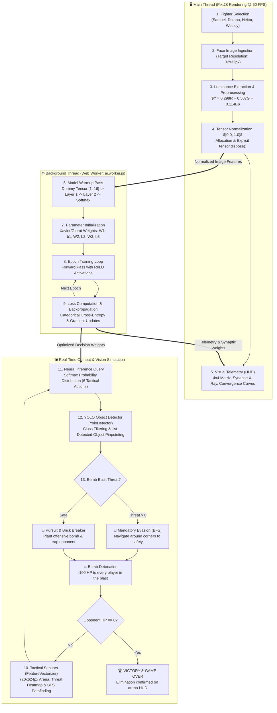

# Bomberman Family · AI Vision & Deep Neural Combat Lab

A production-grade, interactive educational laboratory for **Machine Learning Engineering**, **Computer Vision**, and **Real-Time Autonomous Agent Systems**. The project demonstrates how raw visual data transforms into tactical decision-making policies in a dynamic game arena, executing neural network training in background threads (*Web Workers*) while maintaining a responsive $60\text{ FPS}$ rendering loop.

## 📌 Executive Summary

The **Bomberman Family AI Lab** demonstrates how image-derived luminance features and real-time spatial sensor telemetry can feed a tactical MLP agent. Those image features are not semantic embeddings from a language model. Each family member (**Samuel, Daiana, Heitor, and Wesley**) is initialized with a distinct hyperparameter configuration (varying training epochs, learning rates, and hidden layer dimensions).

Users can observe the mathematical convergence of the model in real time via live loss curves, synapse weight inspectors (X-Ray view), browser console audit logs, and a simulated **YOLOv8** object detection HUD. The in-page study console also provides separate, clearly labeled simulations for selected AI and LLM concepts.

## 🏛️ System Architecture



## ⚖️ Architectural Comparison: Bomberman AI Lab vs. HR Recommendation Engine

The following breakdown highlights the technical and algorithmic divergence between real-time spatial policy agents and asynchronous information retrieval engines:

| Technical Dimension | 💣 Bomberman AI Combat Lab | 👔 HR Recommendation Engine |
| :--- | :--- | :--- |
| **Problem Formulation** | Markov Decision Process (MDP) / Discrete Action Policy | Two-Stage Information Retrieval & Learning-to-Rank (LTR) |
| **Operational Domain** | Real-time spatial navigation, combat, and survival | High-dimensional semantic matching & talent placement |
| **Input Data Modality** | Vision / Spatial: $32 \times 32$ luminance grid + map sensors | Unstructured text resumes, job descriptions, skill graphs |
| **Feature Representation** | Continuous arrays $[0.0, 1.0]$ and discrete distance matrices | Dense contextual embeddings ($d = 384$ or $768$) via Transformers |
| **Network Architecture** | Deep MLP ($16 \to H_1 \to H_2 \to 6$) with ReLU activations | Two-Tower Bi-Encoder + GBDT / Cross-Encoder Re-Ranker |
| **Inference Frequency** | Continuous high-frequency cycle (Tactical step every $220\text{ ms}$) | Asynchronous, query-triggered, or scheduled batch jobs |
| **Execution Environment** | Client-side web browser with multithreaded **Web Workers** | Distributed cloud backend (FastAPI, Redis, Qdrant/FAISS) |
| **Optimization Objective** | $\mathcal{L}_{\text{CCE}} = -\log(P_{\text{target action}})$ | Contrastive Triplet / InfoNCE Loss + LambdaMART ranking |
| **Primary Goal** | Obstacle destruction, BFS evasion, opponent elimination | Relevance scoring, precision retrieval, career suitability |
| **Evaluation Metrics** | Survival duration, loss convergence rate, win percentage | $\text{NDCG}@K$, $\text{Precision}@K$, $\text{Recall}@K$, $\text{MRR}$ |
| **Safety & Governance** | Blast damage applies to both players, including the bomb owner; agents use BFS to escape | Demographic parity, anti-bias audits, disparate impact checks |

## 🔬 Mathematical Formulations & Pipelines

### 1. Computer Vision & Preprocessing (`ImageVectorizer.js`)

* **Spatial Resampling:** Input candidate portrait images are downsampled to a standard $32 \times 32$ pixel format.
* **Perceptual Luminance Conversion:** The image is partitioned into a $4 \times 4$ grid (16 sub-blocks of $8 \times 8$ pixels each). The perceptual luminance $Y$ of each block is computed according to ITU-R BT.601 standards:

$$Y = 0.299 \cdot R + 0.587 \cdot G + 0.114 \cdot B$$

* **Tensor Normalization:** Each value is mapped to the range $[0.00, 1.00]$ to prevent numerical instability and exploding gradients:

$$x_{\text{norm}} = \frac{Y}{255.0}$$

* **Explicit Memory Disposal (`tensor.dispose()`):** Because canvas image buffers consume browser heap memory, temporary buffers are explicitly dereferenced and tracked through the `TensorMemoryTracker` to guarantee zero memory leaks across re-trainings.

### 2. Deep Multilayer Perceptron Architecture (`ai.worker.js`)

Decisions are evaluated by a deep feedforward network running in an isolated background thread:

* **Input Layer ($16$ Dimensions):**
  * $4$ inputs: Walkable directional indicators $(\text{Up}, \text{Down}, \text{Left}, \text{Right})$.
  * $4$ inputs: Directional bomb danger values.
  * $1$ input: Current cell danger level.
  * $1$ input: Evasion viability index $(\text{Can escape if bomb planted})$.
  * $1$ input: Relative horizontal distance to target ($\Delta x$).
  * $1$ input: Adjacent breakable brick indicator.
  * $4$ inputs: Sampled facial identity features ($f_0, f_1, f_2, f_3$).

* **Hidden Layers (Layer 1 & Layer 2):** Equipped with Rectified Linear Unit (**ReLU**) activations:

$$\text{ReLU}(z) = \max(0, z)$$

* **Output Layer ($6$ Neurons):** A **Softmax** function maps logits to an action probability distribution:

$$P(\text{Action}_k) = \frac{e^{z_k}}{\sum_{j=0}^{5} e^{z_j}}$$

* **Action Space:**
  `0: UP` | `1: DOWN` | `2: LEFT` | `3: RIGHT` | `4: BOMB` | `5: WAIT`

* **Loss Function:** Optimized via Categorical Cross-Entropy Loss:

$$\mathcal{L}_{\text{CCE}} = -\sum_{k=0}^{5} y_k \log(\hat{y}_k)$$

### 3. Model Warmup Phase

Prior to competition, the worker executes `warmup()`. A synthetic tensor $[1, 16]$ with values $0.5$ is passed through the network:
* Triggers JavaScript engine JIT compilation.
* Allocates weight matrices ($W_1, W_2, W_3$) and bias vectors in memory.
* Benchmarks inference baseline latency ($\approx 0.05\text{ ms} - 0.20\text{ ms}$) without dropping frames on the main thread.

## 👥 Fighter Training Profiles

The system configures distinct learning hyperparameter sets to model the effect of training volume on strategic competence:

| Fighter | Epochs | Learning Rate ($\alpha$) | Hidden Architecture ($H_1 / H_2$) | Behavioral Profile |
| :--- | :---: | :---: | :---: | :--- |
| **Samuel** | 12 | 0.080 | 16 / 8 | **Novice:** High residual loss ($\approx 0.85$); hesitates, exhibits jitter, occasionally misses optimal evasion paths. |
| **Daiana** | 28 | 0.050 | 28 / 14 | **Intermediate:** Moderate loss ($\approx 0.35$); clear brick-clearing behavior and defensive posture. |
| **Heitor** | 50 | 0.030 | 48 / 24 | **Advanced:** Low loss ($\approx 0.12$); strong BFS retreat execution, aggressive enemy pursuit. |
| **Wesley** | 85 | 0.015 | 64 / 32 | **Grandmaster:** Deep convergence ($\text{Loss} < 0.05$); high confidence ($> 95\%$), lethal trapping tactics. |

## 🎯 YOLO Detection Simulator & Dataset Exporter

The visual perception module emulates an embedded **YOLOv8** bounding-box detector:

1. **Spatial Coordinate Space:** Matches the arena display of $720 \times 624$ pixels ($15 \times 13$ grid cells of $48\text{px}$).
2. **Class Filtering:** Real-time filtering by class ID:
   * `Class 0`: Player 1 (P1)
   * `Class 1`: Player 2 (P2)
   * `Class 2`: Active Bomb
   * `Class 3`: Fire / Explosion Blast
3. **Primary Object Targeting:** Highlights the first detected entity matching the selected filter with a bright cyan bounding box, displaying Cartesian pixel coordinates and normalized YOLO bounding boxes:

$$\langle\text{class\_id}\rangle \quad \langle c_x\rangle \quad \langle c_y\rangle \quad \langle w\rangle \quad \langle h\rangle$$

where $c_x, c_y, w, h \in [0.000, 1.000]$.

4. **Automated Dataset Export (`DatasetExporter.js`):** Clicking **`📥 Export Dataset`** captures the current PixiJS render canvas as a `.png` image and writes the corresponding `.txt` annotation file, ready for model fine-tuning pipelines.

## ⚔️ Combat Mechanics & Arena Physics

* **Player-to-Player Physical Collision (PvP):** Agents cannot occupy or pass through the same grid coordinate.
* **Blast Damage:** Each player in an explosion, including the bomb owner, loses $100\%\text{ HP}$ and is eliminated in one hit.
* **Damage & Elimination:** Each player starts with $100\%\text{ HP}$. A surviving player wins; simultaneous elimination is a draw.
* **Floating Text Feedback:** Displays dynamic floating text indicators (`-100 HP!` and `💀 ELIMINATED!`) directly above characters.
* **Victory Condition:** A match concludes strictly when an agent reduces the opponent's HP to zero.

## 📂 Project Directory Structure

```
BombermanFamily_imageAI_training/
├── index.html                   # Lab UI, arena viewport, synapse X-Ray & telemetry HUD
├── package.json                 # Dependency definitions (PixiJS 8, Vite)
├── README.md                    # System technical documentation
└── src/
    ├── main.js                  # Engine bootstrap, ticker loop, HUD integration & events
    ├── config/
    │   └── constants.js         # Arena dimensions, YOLO classes & fighter hyperparameters
    ├── core/
    │   └── Logger.js            # Multi-thread categorized console and telemetry logger
    ├── entities/
    │   ├── Bomb.js              # Bomb entity, pulsing animation, and detonation timer
    │   ├── Explosion.js         # Cross-blast propagation and destructible tile handling
    │   └── Player.js            # Character rendering, texture masking, PvP collisions & HP
    ├── map/
    │   ├── Grid.js              # Tilemap layout renderer (solid and breakable walls)
    │   └── MazeGenerator.js     # Procedural arena generator with safe spawn zones
    └── ml/
        ├── ai.worker.js         # Web Worker: Warmup, Deep MLP (2 layers), loss & inference
        ├── DatasetExporter.js   # YOLO training dataset packager (.png + .txt)
        ├── FeatureVectorizer.js # Arena sensor extraction and BFS escape pathfinding
        ├── ImageVectorizer.js   # 32x32 facial cropping, luminance, normalization & dispose()
        ├── StudyConsole.js      # Interactive, didactic AI/LLM concept simulations
        └── YoloDetector.js      # Bounding-box detection engine and class filter
```

## 🚀 Getting Started

### Prerequisites

* **Node.js** ($v18.0.0$ or higher recommended).
* Modern web browser with ES Module and Web Worker support (Chrome, Edge, Firefox, Brave, Safari).

### Installation & Launch

1. Navigate to the project root directory:

```bash
cd BombermanFamily_imageAI_training
```

2. Install runtime and build dependencies:

```bash
npm install
```

3. Start the local Vite development server:

```bash
npm start
```

4. Open your browser and navigate to:

```text
http://localhost:5173/
```

### In-page study paths

The study console has two independent paths:

1. **Conceitos básicos** presents the ten course assessment questions on embeddings,
   sampling, genetic algorithms, RAG/MCP, self-attention, Neo4j, neural-network layers,
   and MCP components. Each question includes a dedicated diagram that updates with
   the selection, then reveals the correct option, an explanation, and an explicit
   comparison with the game. Comparisons distinguish actual game behavior from
   concepts that are only analogies or are not implemented.
2. **Estudo guiado · Checkpoints de validação** follows the five implementation stages
   described below. It focuses on the game's live processing pipeline rather than the
   general assessment topics.

The two paths are selectable independently; progress in one does not replace the other.

### In-page validation-checkpoint lessons

The **Estudo guiado · Checkpoints de validação** card follows the same five stages as
the validation panel: **Tela & Recorte**, **Luminância RGB**, **Norm & dispose()**,
**Warmup & Treino**, and **YOLO 1º Objeto**. Each checkpoint has a short explanation, a
live-data activity, and a quiz. Its separate diagram canvas is in the dashboard, never
on top of the running game. Complete a quiz to unlock the next checkpoint; use the
selector to revisit any stage.

The guided-study panel is connected to the game running in the same browser tab. It
refreshes local player positions/HP, MLP action probabilities, training progress, bomb
count, and detections approximately every 100 ms; it does not connect to another
computer or a remote match.

The neural-network X-ray shows actual trained weights for W1, W2, and W3 and the
current inference activations: **IN (16) → ReLU → Extra/ReLU → Softmax (6 actions)**.
The animated dots indicate signal flow during inference. Connections are initialized
with the model and their weights are adjusted during training; the animation does not
mean new connections are created on every move.

The diagrams use the current preprocessing values, warmup/training telemetry, MLP
probabilities, and filtered detections. In **Warmup & Treino**, the six action
probabilities are compared side by side with an illustrative LLM next-token distribution.
Temperature, Top-K and Top-P affect only the LLM example; the arena's MLP and tactical
rules do not use them. The YOLO boxes in this project are a teaching simulation based on
known object positions, not inference from trained YOLOv8 weights.

## 🔍 Validation & Console Audit Checkpoints

Press **`F12`** in your browser to open Developer Tools and select the **Console** tab. The laboratory outputs structured, color-coded checkpoints:

* `[CHECKPOINT 1 - INPUT]` Displays canvas dimensions ($720 \times 624\text{px}$) and downsampled avatar dimension ($32 \times 32\text{px}$).
* `[CHECKPOINT 2 - LUMINÂNCIA RGB]` Validates RGB-to-luminance conversion and the 16 raw block averages $[0, 255]$.
* `[CHECKPOINT 3 - NORM & DISPOSE]` Shows the conversion to normalized features $[0.00, 1.00]$ and confirms the temporary raw tensor was released.
* `[CHECKPOINT 4 - WARMUP]` Logs model warmup execution time in milliseconds for the 2-hidden-layer network; training epochs and loss are reported at the same checkpoint.
* `[CHECKPOINT 4 - EPOCHS]` Audits training convergence every 10 epochs, displaying falling categorical loss and rising classification confidence.
* `[CHECKPOINT 5 - YOLO]` Outputs the coordinates, class ID, and confidence score of the primary detected object in real time.